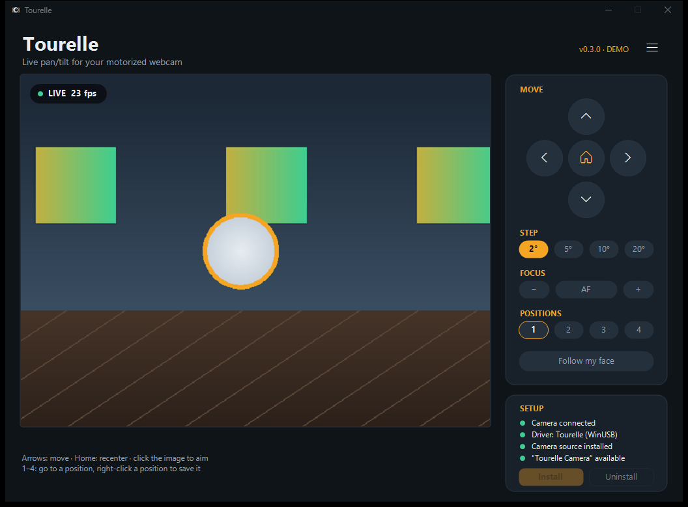

# Tourelle


**Live pan/tilt for the motorized Logitech® QuickCam® Sphere AF webcam on Windows 11, with no vendor driver.**

The camera's motorized head stopped working when its original driver stopped
being supported: Windows 11 still shows the video, but nothing can turn the
head. Tourelle (French for *turret*) brings the motors back. It runs the camera
from user mode and republishes it as a standard Windows 11 virtual camera, so
you can steer the head **while** Teams, Zoom, OBS or the Camera app are
using it.

> Tourelle is an independent open-source project. It is **not affiliated with,
> endorsed by, or sponsored by Logitech**. See [Trademarks](#trademarks).



## Features

- **Live pan/tilt** from the app, the keyboard, global shortcuts or an Xbox controller, while
  any app uses the camera.
- **Click to aim**: click a point of the preview and the head centers it.
- **Four saved positions** that the head returns to.
- **Face following** with the face detector built into Windows.
- **Focus**: the camera's focus motor, with near/far buttons and contrast autofocus.
- **Standard Windows camera controls**: apps and Windows can drive pan, tilt, focus, brightness,
  contrast, white balance and the other image settings without Tourelle.
- **Video**: 640×480 at 30 fps, 800×600 at 25 fps, 960×720 at 10 fps (NV12 or YUY2).
- **Interface**: English, French, Spanish and Polish. Notification area icon, start with Windows.
- **One-click setup and uninstall**, with no third-party driver and no kernel code.

## Status

| | |
|---|---|
| Tested camera | QuickCam Sphere AF, USB `046D:0994`, firmware `bcdDevice 0x0008` |
| OS | Windows 11 (virtual cameras need build 22000 or later) |
| Audio | the webcam microphone keeps its own Windows driver |

Other cameras with the same USB ID (the Orbit AF shares it) should work. They are untested.

## Install

1. Download `tourelle-setup-<version>.exe` from the [Releases](../../releases) page and run it.
2. Plug in the camera and start **Tourelle**. If the camera was not plugged in during setup, click
   **Install** once.
3. In your video app, select **Tourelle Camera**.

A portable `tourelle-windows-x64.zip` is also available. Extract it, then run `Tourelle.exe` and
click **Install**.

> The binaries are not code-signed yet, so Windows SmartScreen may show "unknown publisher". See
> [docs/signing.md](docs/signing.md).

## Use

| Action | Mouse | Keyboard (window) | Anywhere |
|---|---|---|---|
| Move | ◀ ▲ ▶ ▼ buttons | arrows | Ctrl+Alt+arrows |
| Recenter | ⌂ | Home | Ctrl+Alt+Home |
| Aim at a point | click the preview | | |
| Go to a saved position | 1 – 4 buttons | 1 – 4 | Ctrl+Alt+1 – 4 |
| Save a position | right-click 1 – 4 | | |
| Follow my face | *Follow my face* | F | Ctrl+Alt+F |
| Focus | − / AF / + | | |

**Xbox controller**: the left stick moves the head, the D-pad moves it step by step, A recenters,
B follows your face and X runs the autofocus.

The **☰ menu** holds the options: inverting left/right or up/down, language, global shortcuts,
controller, image settings, start with Windows, diagnostics, and the About, License and Notices
pages.

Closing the window keeps Tourelle in the notification area, next to the clock. The camera, and its
LED, switch off a few seconds after the last app stops using it.

Scripting: `tourelle-cli move <pan°> <tilt°>`, `goto`, `reset`, `where`, `focus [0-255]`.

## How it works

```
 Teams / Zoom / OBS / Camera app            Tourelle.exe / tourelle-cli
            │  "Tourelle Camera"                      │ IKsControl (standard + private)
            ▼  (Windows 11 virtual camera, Frame Server)▼
 TourelleCamera.dll ── Media Foundation source ── motor worker (absolute position)
            │  user-mode UVC driver: probe/commit, isochronous streaming, frame assembly
            ▼
 WinUSB (Microsoft driver, bound to the camera's video function)
            ▼
 Camera ── video stream (interface 1)  +  hidden motor unit (interface 0, unit 9)
```

The camera does expose its motors as a UVC extension unit (GUID
`63610682-5070-49AB-B8CC-B3855E8D2256`). But the unit is declared in a
vendor-specific descriptor (type `0x41` instead of the standard `0x24`).
Windows' class driver `usbvideo.sys` therefore never learns that it exists. So
Tourelle hands the video function to WinUSB and does the class driver's job
itself. [docs/how-it-works.md](docs/how-it-works.md) tells the full investigation.

## Build and test

Requirements: Visual Studio 2022 (or Build Tools) with the C++ workload and the Windows 11 SDK.

```bat
native\build.cmd                      :: build into native\build
native\build\tourelle-tests.exe       :: unit tests, no camera needed
native\build\Tourelle.exe --demo      :: the app with a synthetic image, no camera needed
```

The CI runs the build with warnings as errors, the unit tests, the MSVC code analysis (`/analyze`),
the unit tests under AddressSanitizer, and PSScriptAnalyzer. It also builds the installer.
[CONTRIBUTING.md](CONTRIBUTING.md) describes the layout and the hardware checks.

## Privacy

Tourelle collects, stores and sends no data. The video never leaves your computer. *Copy
diagnostics* only puts text on your clipboard, and only when you ask for it.

## Trademarks

Logitech, QuickCam, Orbit and Sphere are trademarks or registered trademarks of
Logitech and/or its affiliates. They are used here only to identify the
hardware this software is compatible with.

Tourelle contains no Logitech code, firmware, drivers, logos or other assets.
It talks to the camera only through what the device itself reports over USB,
plus publicly documented UVC requests. The extension-unit GUIDs and control
selectors used here also appear in the open-source `libwebcam`/`uvcdynctrl`
mappings that Logitech published for Linux. The work was done for
interoperability with hardware the author owns.

This software is provided as is, without warranty: see [LICENSE](LICENSE).
Use at your own risk.

## License

[MIT](LICENSE). Security reports: see [SECURITY.md](SECURITY.md).
