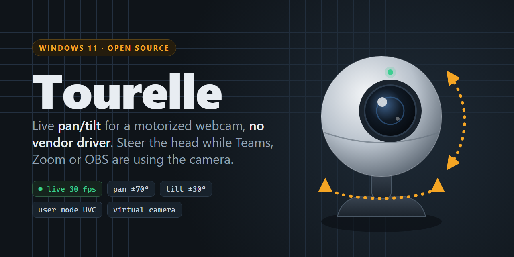

# Tourelle



**Live pan/tilt for the motorized Logitech® QuickCam® Sphere AF webcam on Windows 11, with no vendor driver.**

The camera's motorized head stopped working when its original driver stopped
being supported: Windows 11 still shows the video, but nothing can turn the
head. Tourelle (French for *turret*) brings the motors back. It runs the camera
from user mode and republishes it as a standard Windows 11 virtual camera, so
you can steer the head **while** Teams, Zoom, OBS or the Camera app are
using it.

> Tourelle is an independent open-source project. It is **not affiliated with,
> endorsed by, or sponsored by Logitech**. See [Trademarks](#trademarks).

## Status

| | |
|---|---|
| Tested camera | QuickCam Sphere AF, USB `046D:0994`, firmware `bcdDevice 0x0008` |
| OS | Windows 11 (virtual cameras need build 22000 or later) |
| Video | 640×480 at 30 fps (NV12 or YUY2) |
| Motors | pan ±70°, tilt ±30°, recenter |
| Audio | the webcam microphone keeps its own Windows driver |

Other cameras with the same USB ID (the Orbit AF shares it) should work. They are untested.

## How it works

```
 Teams / Zoom / OBS / Camera app
            │  "Tourelle Camera"  (Windows 11 virtual camera, Frame Server)
            ▼
 TourelleCamera.dll  ── Media Foundation source ── IKsControl ◄── Tourelle.exe (arrows) / tourelle-cli
            │  user-mode UVC driver: probe/commit, isochronous streaming, frame assembly
            ▼
 WinUSB (Microsoft driver, bound to the camera's video function)
            ▼
 Camera ── video stream (interface 1)  +  hidden motor unit (interface 0, unit 9)
```

The camera does expose its motors as a UVC extension unit (GUID
`63610682-5070-49AB-B8CC-B3855E8D2256`). But the unit is declared in a
vendor-specific descriptor (type `0x41` instead of the standard `0x24`).
Windows' class driver `usbvideo.sys` therefore never learns that it exists and
cannot forward any request to it. Only the owner of the video control interface
can reach the unit. So Tourelle takes that interface over through WinUSB and
does the class driver's job itself.

[docs/how-it-works.md](docs/how-it-works.md) tells the full investigation: the descriptor dumps, the dead
ends and the protocol details.

## Install

1. Download `tourelle-windows-x64.zip` from the [Releases](../../releases) page and extract it.
2. Plug in the camera and run **`Tourelle.exe`**.
3. Click **Install** and accept the administrator prompt. Tourelle then:
   - hands the camera's video function to Microsoft's WinUSB driver;
   - installs its camera source in `C:\Program Files\Tourelle`;
   - registers the **Tourelle Camera** virtual camera for your user.

The live preview starts as soon as setup is done.

## Use

- **In Tourelle.exe**: the arrow buttons or the keyboard arrows move the head,
  and **⌂** or the Home key recenters it. You can also pick the step size (2° to 20°, or keys 1–4).
- **From the notification area**: closing the window keeps Tourelle next to the
  clock. Click the icon to open it again; right-click it to recenter the head,
  turn **Start with Windows** on or off, or quit. While the window is hidden, the
  preview stops, so the camera is only busy when an app uses it.
- **In your video app**: select **Tourelle Camera**. Keep Tourelle.exe open next
  to it and steer the head during the call. Several apps can use the camera at the same time.
- **From scripts**: `tourelle-cli move <pan°> <tilt°>` and `tourelle-cli reset`.

## Uninstall

In Tourelle.exe, click **Uninstall**. The camera goes back to the Windows driver,
and the camera source and the virtual camera are removed.

## Build from source

Requirements: Visual Studio 2022 (or Build Tools) with the C++ workload and the Windows 11 SDK.

```bat
native\build.cmd
```

The outputs land in `native\build\`:

| File | Description |
|---|---|
| `Tourelle.exe` | The app: live preview, pan/tilt controls, notification area icon, one-click install/uninstall |
| `TourelleCamera.dll` | Media Foundation source loaded by the Frame Server (keep it next to Tourelle.exe) |
| `tourelle-cli.exe` | Scripting: `enable`, `remove`, `move`, `reset` |
| `uvcgrab.exe` | Stand-alone test: streams for about 10 s, moves the head during the stream, saves a frame |

`tools\dumpdesc.ps1` dumps the raw USB descriptors, including the hidden
`0x41` units, of any device. It is useful for checking whether another camera
has the same layout.

## Limitations

- Only 640×480 is published for now. The camera also offers MJPEG up to 960×720 and YUY2 up to 1600×1200 at 5 fps.
- While Tourelle owns the camera, Windows sees only "Tourelle Camera", not the physical camera.
- Install and uninstall need administrator rights (one UAC prompt each).
- The motor protocol was confirmed on a single unit with firmware `0x0008`.

## Trademarks

Logitech, QuickCam, Orbit and Sphere are trademarks or registered trademarks of
Logitech and/or its affiliates. They are used here only to identify the
hardware this software is compatible with.

Tourelle contains no Logitech code, firmware, drivers, logos or other assets.
It talks to the camera only through what the device itself reports over USB,
plus publicly documented UVC requests. The extension-unit GUIDs and control
selectors used here also appear in the open-source `libwebcam`/`uvcdynctrl`
mappings that Logitech published for Linux. The work was done for
interoperability with hardware the author owns.

This software is provided as is, without warranty: see [LICENSE](LICENSE).
Use at your own risk.

## License

[MIT](LICENSE)
